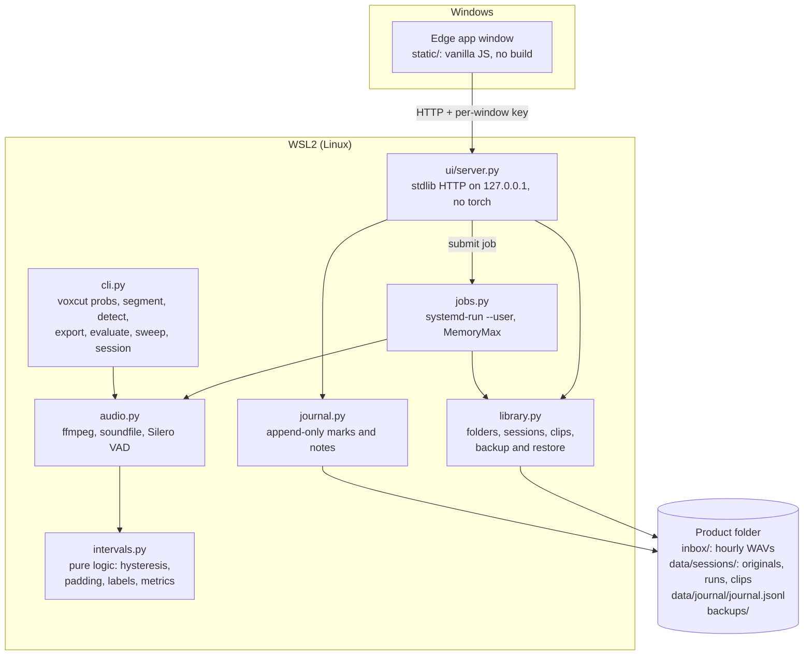

# Architecture

VoxCut is one Python package with two front doors: a CLI and a browser UI. Both use the same modules; only the job runner loads the model.

`make ui` (`ui/launch.py`) starts the server and opens the Edge window with a one-time code, which the page exchanges for its per-window key.

## Data flow

1. **Import.** Hourly WAVs move from `inbox/<folder>/` into `data/sessions/<id>/originals/`, unchanged, with sha256 checked before and after.
2. **Process** (a job). `audio.py` checks each file, assembles one session WAV, runs Silero VAD in two passes and writes probabilities; `intervals.py` turns them into padded segments; clips are cut from the source with a manifest. Each step writes a new run directory (`<dir>.tmp`, then `os.replace`); nothing is overwritten.
3. **Review.** The UI plays clips and appends decisions and notes to the journal. Nothing is deleted.
4. **Backup and restore** (jobs). A tar of `data/`, journal included.

## Boundaries

- **The model stays in jobs.** The server never imports torch; heavy steps run as `systemd-run --user` units with a memory cap, one at a time, so a long recording cannot take down WSL.
- **`intervals.py` is pure.** No torch, no I/O: the decision logic is fast to test.
- **ffmpeg through one helper**, as an argument list, never a shell; a non-zero exit is a refusal.
- **The UI server** binds to 127.0.0.1 and checks Host, Origin and a per-window key; a strict CSP forbids inline code.

## Stack

| Layer | What | Why |
|---|---|---|
| Language | Python 3.12 | one language for the CLI, the jobs and the server |
| Model | Silero VAD 6.2.3 on torch 2.14.1 (CPU build) | small, local, good recall on whispers with resets; versions pinned with anchor tests |
| Audio | ffmpeg, libsndfile (`soundfile`), numpy | decoding and bit-exact cutting; two decoders cross-check each file |
| Jobs | systemd user units (`systemd-run`, `voxcut.slice`) | memory cap and isolation from the server |
| Server | Python standard library (`http.server`) | no web framework to update or audit |
| Frontend | vanilla JS, no bundler; Basecoat CSS, Tailwind-derived styles, Lucide icons, Mulish font (vendored) | nothing to build; works offline |
| UI host | Microsoft Edge app window, InPrivate, on Windows 11 + WSL2 | the target machine |
| Config | TOML (`configs/v1.toml`) | the calibrated detector settings |
| Tests and lint | pytest, ruff; GitHub Actions on Ubuntu 24.04 | `make check` is the definition of done |

Third-party licenses are in [THIRD_PARTY_NOTICES.md](../THIRD_PARTY_NOTICES.md); the reasons behind each choice are in the [decision log](decisions.md).
